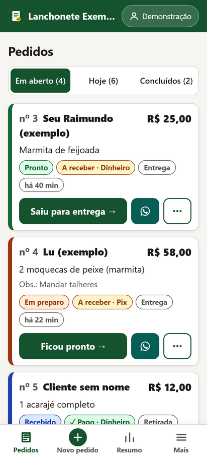
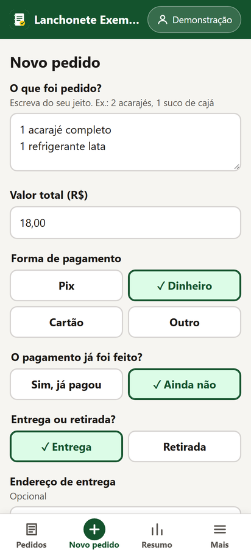
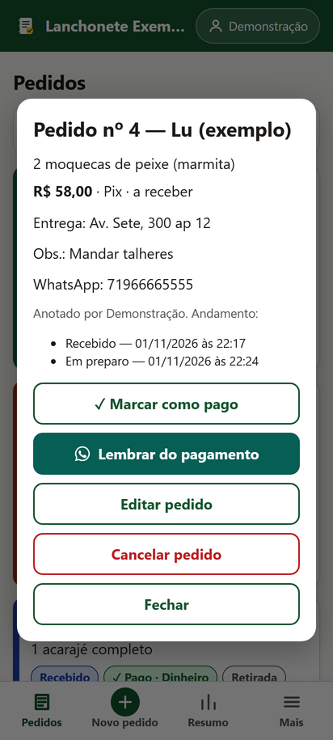
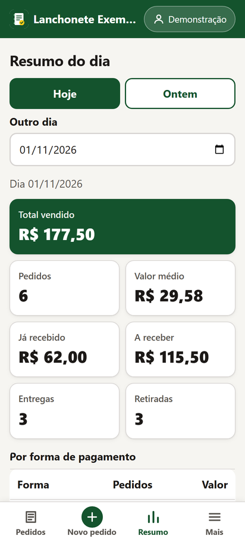
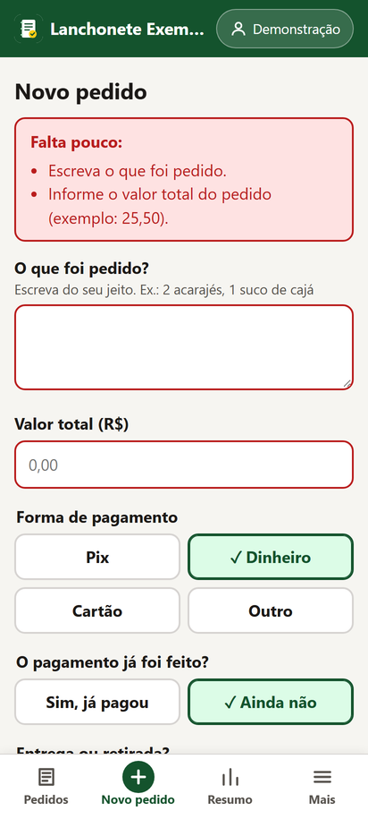
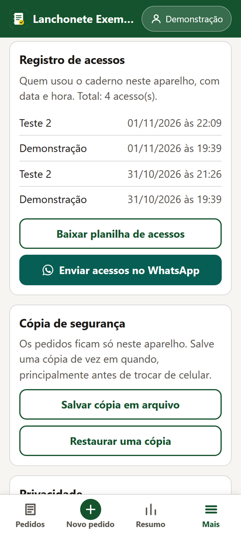
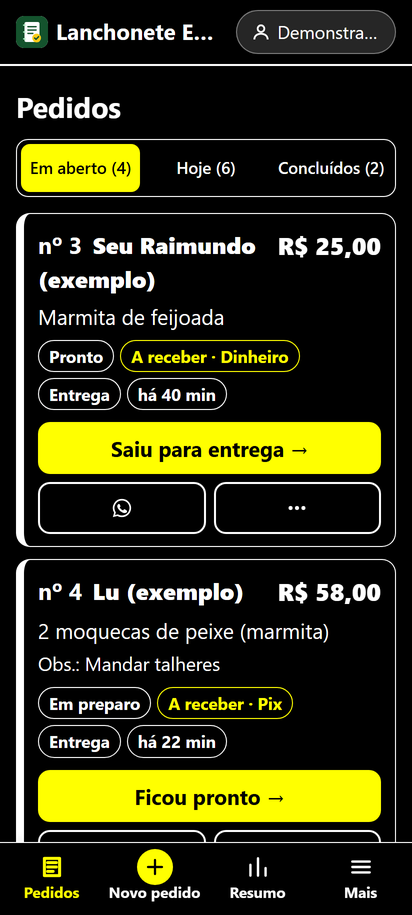

# Caderno de Pedidos

Aplicação web gratuita para **pequenos negócios de alimentação** (lanchonetes, restaurantes de bairro, cozinhas de entrega e vendedores autônomos) anotarem e acompanharem os pedidos pelo celular, no lugar do caderno de papel.

Projeto desenvolvido na disciplina **Atividade Extensionista II** do Curso Superior de Tecnologia em Análise e Desenvolvimento de Sistemas (Centro Universitário Internacional Uninter), dando continuidade ao levantamento feito na Atividade Extensionista I. Uso gratuito e **sem fins comerciais**.

- **Aluno:** Levi Vieira de Sousa (RU 4506310)
- **Comunidade atendida:** pequenos negócios de alimentação de Salvador/BA
- **ODS relacionados:** ODS 8 (Trabalho decente e crescimento econômico) e ODS 9 (Indústria, inovação e infraestrutura)

## O problema

O levantamento da Atividade Extensionista I indicou que esses negócios recebem a maior parte dos pedidos pelo WhatsApp, mas organizam tudo em cadernos, papéis soltos ou na própria conversa. Isso dificulta saber o que já foi preparado, quem já pagou, o que saiu para entrega e quanto foi vendido no dia.

## O que o app faz

| Funcionalidade | Como ajuda |
| --- | --- |
| **Anotar pedido** em poucos toques (o que foi pedido, valor, forma de pagamento, entrega ou retirada) | substitui o caderno; só dois campos são obrigatórios |
| **Andamento do pedido** com um botão grande: recebido → em preparo → pronto → saiu para entrega → entregue (ou retirado) | ninguém esquece pedido parado |
| **Pago / a receber** em cada pedido, com lembrete de pagamento | controle de quem falta pagar |
| **Mensagens prontas no WhatsApp** para cada etapa (confirmação, em preparo, pronto, saiu, cobrança com chave Pix) | comunicação com o cliente sem digitar |
| **Resumo do dia**: total vendido, recebido, a receber, valor médio, por forma de pagamento | fechamento de caixa simples |
| **Desfazer** logo depois de cada ação | tolerância ao erro |
| **Registro de acessos**: nome de quem usou, data e hora, com planilha (CSV) | acompanhamento do uso |
| **Letra grande/enorme e alto contraste** | acessibilidade |
| **Funciona sem internet** e pode ser instalado na tela inicial (PWA) | celulares simples e conexão instável |
| **Cópia de segurança** em arquivo e limpeza de pedidos antigos | segurança e privacidade dos dados |

### Telas

| Pedidos | Novo pedido | Opções do pedido | Resumo do dia |
| --- | --- | --- | --- |
|  |  |  |  |

| Validação | Registro de acessos | Alto contraste | Mensagem pronta |
| --- | --- | --- | --- |
|  |  |  |  |

*Prints com dados fictícios de demonstração.*

## Privacidade (LGPD)

- Nada é enviado para servidor: os dados ficam **somente no aparelho** do negócio (`localStorage` do navegador).
- Do cliente, o app pede apenas o necessário e tudo é opcional: nome ou apelido e, se o negócio quiser mandar avisos, o WhatsApp.
- O registro de acessos guarda só o nome que a pessoa digitou, a data e a hora, e avisa isso na tela.
- Há botões para apagar pedidos finalizados com mais de 30 dias e para apagar todos os dados.

## Como usar

Abra o endereço publicado no navegador do celular (Chrome, Edge, Samsung Internet ou Safari). Para instalar: menu do navegador → **Adicionar à tela inicial** (ou o botão **Instalar no celular** em *Mais*).

Para rodar no computador:

```bash
npm start          # sobe um servidor local em http://localhost:8080
# ou, sem Node:
python -m http.server 8080
```

Também dá para abrir o `index.html` direto, mas aí o modo sem internet (service worker) não é ativado.

## Testes

As regras de negócio ficam em [`js/core.js`](js/core.js), separadas da tela, e têm testes automatizados com o executor nativo do Node.js (versão 18 ou mais nova):

```bash
npm test
```

## Tecnologias e decisões

- HTML, CSS e JavaScript puros, **sem dependências e sem etapa de build**: o app é leve, carrega rápido em celular simples e qualquer pessoa consegue estudar o código.
- Hospedagem estática gratuita (GitHub Pages), **custo zero** para o negócio.
- `localStorage` em vez de banco de dados em nuvem: sem cadastro, sem senha e sem mensalidade, e os dados não saem do aparelho.
- Acessibilidade seguindo os 7 princípios do Desenho Universal e a WCAG 2.2: alvos de toque de no mínimo 48 px, rótulos em todos os campos, cor nunca usada sozinha (sempre com texto), foco visível, avisos lidos por leitor de tela (`aria-live`), linguagem simples e opção de desfazer.

## Estrutura

```
index.html            tela principal
css/style.css         estilos (inclui tema de alto contraste e tamanhos de letra)
js/core.js            regras de negócio (sem acesso à tela; testável no Node)
js/app.js             interface, armazenamento e eventos
sw.js                 service worker (funcionar sem internet)
manifest.webmanifest  dados para instalar como app
tests/core.test.js    testes automatizados
docs/requisitos.md    requisitos funcionais e não funcionais
docs/diagramas.md     diagramas UML e BPMN (Mermaid)
```

## Licença

[MIT](LICENSE).
