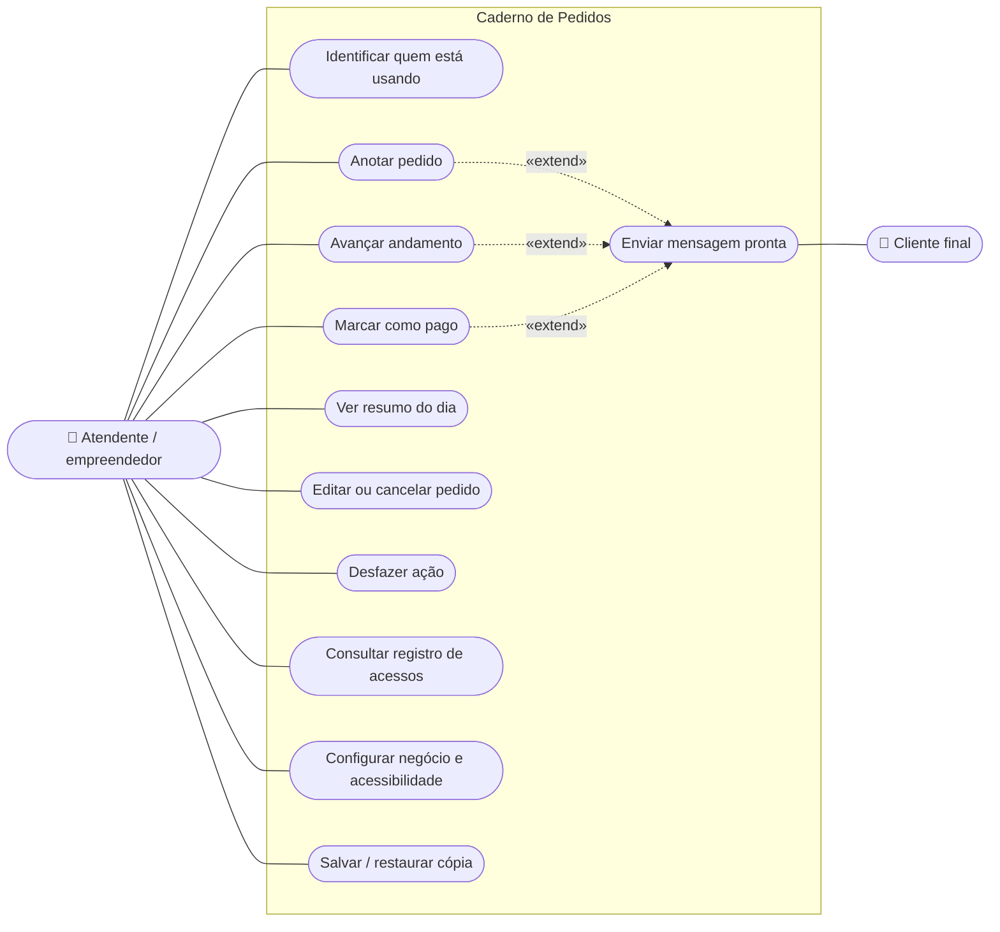
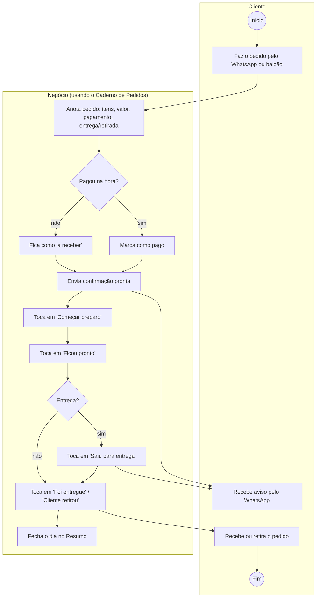
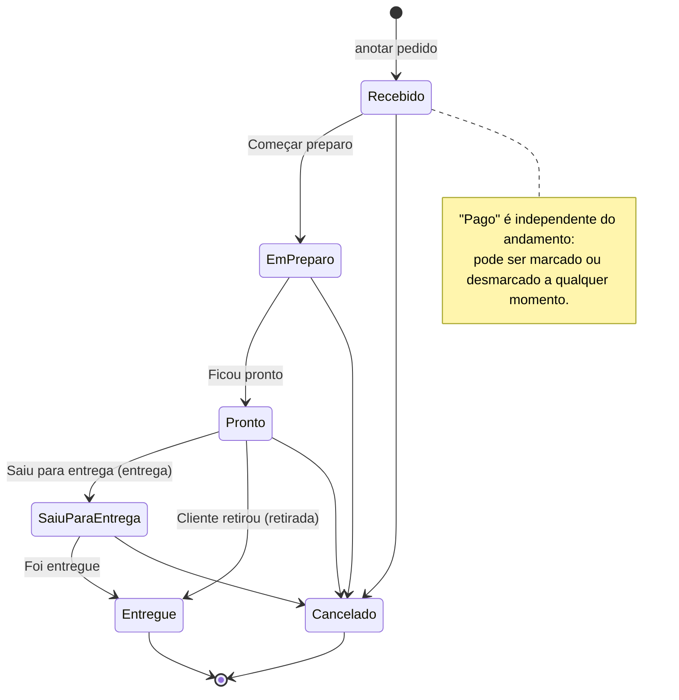
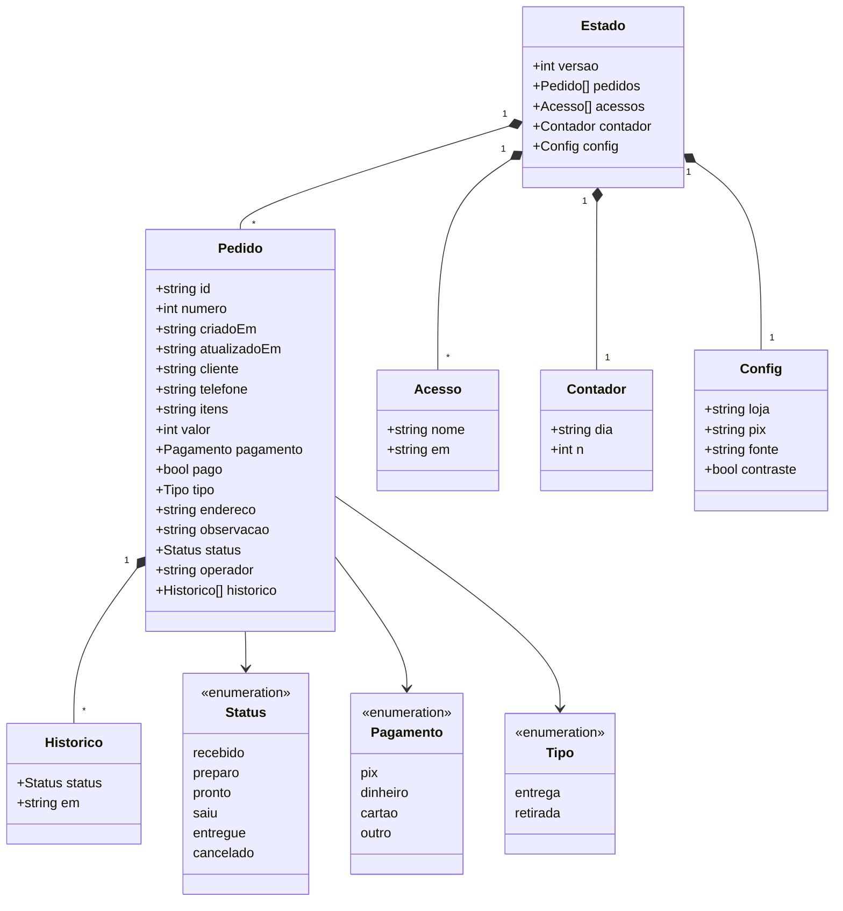
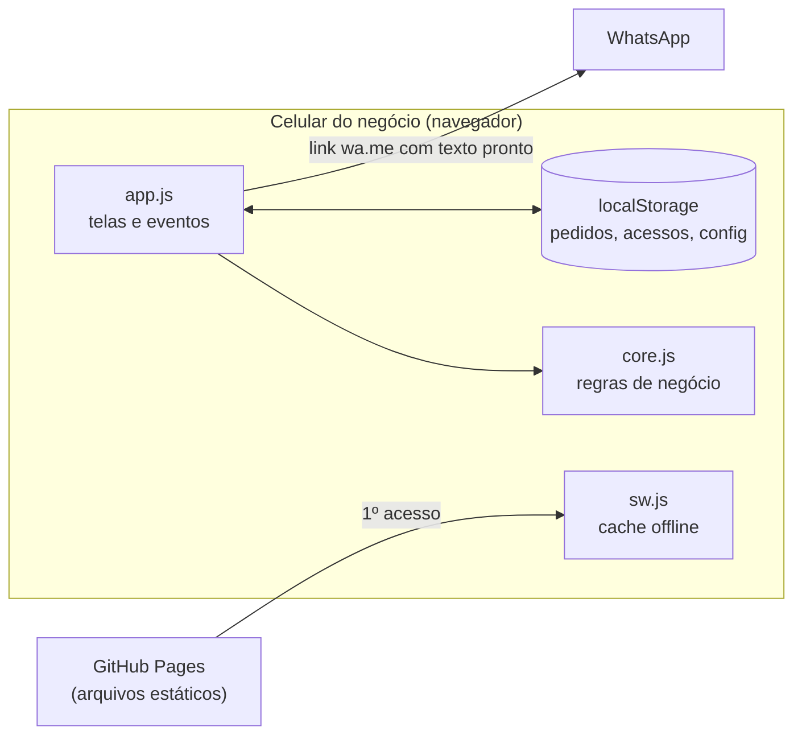

# Diagramas

Os diagramas usam [Mermaid](https://mermaid.js.org/) e aparecem desenhados direto no GitHub.

## 1. Casos de uso (UML)

## 2. Processo de atendimento com o app (BPMN simplificado)

## 3. Estados do pedido (UML)

## 4. Modelo de dados (UML de classes)

## 5. Arquitetura

